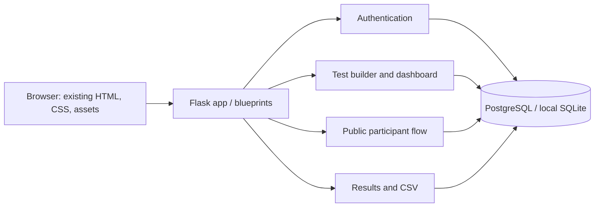
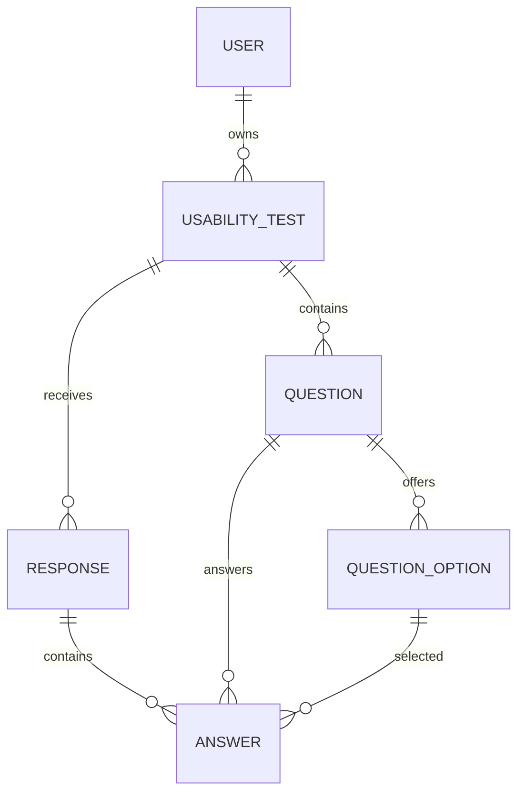

# UsabilityHub

A full-stack user research platform built around the original HTML/CSS landing page. Creators can build, preview, publish, close, reopen, and archive studies; participants can submit five question types without accounts; and creators can inspect stored responses, trends, deterministic insights, and safe CSV exports.

## Architecture





## Stack and design choices

- Python 3 and Flask Blueprints keep request handling modular and explainable.
- Flask-SQLAlchemy maps normalized relational models; Flask-Migrate/Alembic manages schema changes.
- PostgreSQL is configured for deployment. Local development defaults to SQLite.
- Flask-Login provides cookie-based sessions; Werkzeug provides password hashing; Flask-WTF applies CSRF protection.
- Server-rendered Jinja pages reuse the existing landing page instead of replacing the frontend with a framework.
- Deterministic Python insight calculations describe observed counts, ratings, ties, and sample sizes without paid AI or statistical significance claims.

## Local setup

```sh
python -m venv .venv
# Windows: .venv\Scripts\activate
# macOS/Linux: source .venv/bin/activate
pip install -r requirements.txt
copy .env.example .env  # Windows; on macOS/Linux use cp
```

Set `SECRET_KEY` to a private random value before real use. With SQLite (the default), apply the schema and launch:

```sh
flask --app wsgi db upgrade
flask --app wsgi run --debug
```

The repository includes the initial schema and an additive migration that preserves existing studies and answers. It converts old `multiple_choice` questions (which were radio-button/single-select) to `single_choice`, adds lifecycle/methodology fields, supports the new question types, and adds retry idempotency keys. When changing models during development, create a revision with `flask --app wsgi db migrate -m "Describe schema change"`, review it, then apply with `flask --app wsgi db upgrade`.

To use PostgreSQL locally, set `DATABASE_URL` to a PostgreSQL connection string. Commit generated migration revisions. Render's configured start command applies pending migrations before Gunicorn; it currently runs at each startup for free-plan compatibility. Never point tests or development at production data.

## Tests

```sh
pytest
```

The suite uses an isolated in-memory SQLite database and covers authentication, ownership, five question types, validation, question reorder, state transitions, response retry behavior, analytics/insights, CSV safety, and a migration test that verifies existing records survive conversion. It is not a complete security assessment or PostgreSQL integration suite.

## Render deployment

1. Push this repository to GitHub and create a Render Blueprint from `render.yaml`.
2. Review the web service and managed PostgreSQL instance in Render. The blueprint creates the service resources; it does not mean the application is already deployed.
3. Render generates `SECRET_KEY` and injects the managed database URL. Keep both out of source control.
4. The build command installs dependencies. The start command applies committed Alembic migrations before launching `gunicorn wsgi:app`. This keeps the free-plan setup self-contained; `flask db upgrade` applies only pending revisions on each process start. `/health` checks database connectivity, not schema revisions.
5. Confirm the deployed health check and perform an account creation, test publishing, and participant submission in the deployed environment.

The app trusts one proxy hop in production for HTTPS scheme/host forwarding. Secure session cookies are enabled when `FLASK_ENV=production`. Configure an explicit `SECRET_KEY` and a PostgreSQL `DATABASE_URL` in any non-Render hosting environment too.

## Configuration

| Variable | Purpose |
| --- | --- |
| `SECRET_KEY` | Flask session and CSRF signing key; required in production. |
| `DATABASE_URL` | SQLAlchemy database URL; defaults to local `sqlite:///usabilityhub.db`. |
| `FLASK_ENV` | Set to `production` for secure-cookie/proxy configuration. |

## Route overview

| Route | Purpose |
| --- | --- |
| `/` | Existing public marketing page |
| `/auth/register`, `/auth/login`, `/auth/logout` | Account lifecycle |
| `/dashboard` | Current user's studies and response counts |
| `/tests/new`, `/tests/<id>/edit` | Create and manage studies/questions |
| `/tests/<id>/publish`, `/close`, `/reopen`, `/archive` | Study state transitions |
| `/tests/<id>/preview` | Owner-only participant preview |
| `/p/<token>` | Public participant flow |
| `/tests/<id>/results`, `/tests/<id>/export.csv` | Owner-only analytics/export |
| `/health` | Application/database availability |

## Security and data policy

Passwords are hashed, state-changing forms use CSRF tokens, queries are parameterized through SQLAlchemy, private study access checks ownership, participant links use 256-bit random tokens, and rendered user text is escaped by Jinja. CSV cells beginning with spreadsheet formula markers are prefixed to reduce formula injection risk. Production should use HTTPS and a private environment secret. The application stores account email, test/question content, response timestamps, and submitted answers; it does not request participant identity. A public link permits repeat submissions and each is counted independently; browser identity is not treated as a person-level uniqueness guarantee.

Questions cannot be changed or reordered after the first response, and a study with responses cannot be deleted; creators can archive it instead. This preserves the meaning and provenance of collected answers. Each participant page load gets an idempotency key so retrying that submission does not double-count; opening the link again counts as a new response. This is not proof of unique real-world participants. The dashboard has title search and status filtering. Account deletion cascades through the account's studies and data at the database relationship level; there is no self-service account deletion screen yet.

## Known limitations and next steps

This is a portfolio project, not a claim of production security or penetration testing. There is no PostgreSQL integration test service, rate limiting, email verification, account deletion UI, pagination, audit log, or automated text-theme analysis. The dashboard/result routes currently load answer records into process memory; use SQL aggregation and pagination before growing to large datasets. Scale-out should move migrations to a serialized pre-deploy/release job instead of running migration checks in every instance startup.

## Files added or changed

- `index.html`: preserves the landing design while linking signup and usable product entry points.
- `config.py`, `wsgi.py`: environment config and WSGI entry point.
- `app/`: Flask factory, extensions, models, blueprints, templates, and responsive app styling.
- `migrations/`: Alembic schema revisions, including the safe expansion migration.
- `tests/`: isolated critical-path Flask client tests.
- `docs/`: implementation audit, architecture, schema, route reference, testing, deployment, and interview guide.
- `requirements.txt`, `.env.example`, `.gitignore`: dependencies and local configuration hygiene.
- `render.yaml`: Render web service and managed PostgreSQL blueprint.

The repository is configured for Render; no live deployment was created or verified by this implementation pass.

## Interview notes

- **Why separate `Response` and `Answer`?** One submission can answer many questions; relational rows preserve queryable results and avoid a large opaque JSON blob.
- **How is ownership enforced?** Every private operation loads the resource and compares its `owner_id` to the authenticated session user; unknown and foreign IDs both return 404.
- **How does the participant lifecycle work?** A random public token resolves only to a published study. Server-side validation checks required values, option membership, text limits, and rating bounds before committing a submission plus its answers.
- **How are old results protected?** Question structure locks after a first submission; deletion is blocked when responses exist. This prevents existing answers being reinterpreted.
- **How are retry duplicates handled?** A per-form random key and a unique database constraint make a replay idempotent. A new page load gets a new key and counts separately; it does not prove distinct people.
- **What would you improve next?** Add rate limiting/email verification, PostgreSQL integration CI, analytics pagination and SQL aggregation, account deletion UI, and a clearer privacy/retention workflow.
