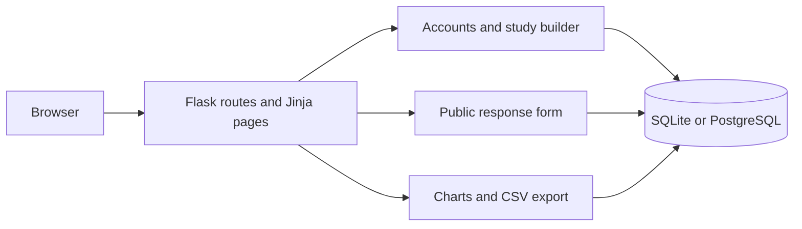

# UsabilityHub

UsabilityHub is a small user research app I built by extending a static UsabilityHub-style website with a Flask backend. A creator can make a study, share it with participants, and review the answers in charts or a CSV file.

[Open the Render demo](https://usability-hub-clone.onrender.com/)

## What it does

- Register, sign in, and manage your own studies.
- Create studies with a title, description, methodology, and optional scheduled close time.
- Build single-choice, multiple-choice, text, rating, and yes/no questions; preview, reorder, and publish them.
- Share a public link that accepts responses without requiring participants to sign in.
- View response distributions, rating charts, submission activity, and written answers; download results as CSV.
- Close, reopen, archive, and search studies from the dashboard.

Screenshots of the current application are not included in the repository yet.

## Technologies

The app uses Python and Flask. Flask Blueprints handle account, study, participant, and results routes. Jinja renders the pages, and the original HTML/CSS and image assets are reused for the landing page. SQLAlchemy stores users, studies, questions, and answers in SQLite locally or PostgreSQL when deployed. Flask-Migrate manages database changes; Flask-Login, Werkzeug password hashing, and Flask-WTF CSRF protection handle the basic account flow.

## How the app is organised



The main workflow is: a signed-in creator builds and publishes a study; participants use its public link to submit answers; the creator views saved responses from the results page. A submission key prevents the same form retry from being counted twice, but opening the link again creates a new response.

## Project structure

```text
app/                 Flask setup, routes, models, templates, and app CSS
assets/              Images used by the site
migrations/          Alembic database migrations
tests/               Flask and migration tests
docs/                Architecture, schema, API, testing, and deployment notes
config.py            Environment-based app configuration
wsgi.py              Gunicorn entry point
render.yaml          Render web service and database configuration
```

## Run locally

You need Python 3.11 or later. From the repository folder, create and activate a virtual environment, then install the packages:

```powershell
python -m venv .venv
.venv\Scripts\Activate.ps1
pip install -r requirements.txt
```

Set `SECRET_KEY` and `DATABASE_URL` in a local `.env` file. For SQLite, use `DATABASE_URL=sqlite:///usabilityhub.db`; PostgreSQL can be used if you have a local database running. The `.env.example` file shows the expected variables, but its database URL assumes a local PostgreSQL server.

Apply the migrations and start Flask:

```powershell
flask --app wsgi db upgrade
flask --app wsgi run --debug
```

Then open `http://127.0.0.1:5000`. Do not use a production database for local development or tests.

## Configuration

| Variable | Use |
| --- | --- |
| `SECRET_KEY` | Signs sessions and CSRF tokens. Set a private value outside local development. |
| `DATABASE_URL` | Database connection string. If omitted, the app uses local SQLite. |
| `FLASK_ENV` | Use `production` for the deployed secure-cookie and proxy settings. |

## Tests

```powershell
python -m pytest -q
python -m compileall -q app tests
```

The tests use an isolated SQLite database. They cover the main account, study, participant, results, and migration flows, but do not connect to the live site or a PostgreSQL server.

## Deployment

The repository includes a Render Blueprint in `render.yaml`. Connect the GitHub repository to Render, create the Blueprint resources, and let Render generate `SECRET_KEY` and provide the managed PostgreSQL `DATABASE_URL`. The start command runs `flask db upgrade` before Gunicorn so pending migrations are applied on startup. `/health` checks database connectivity.

Scheduled close times are enforced when a dashboard or participant request arrives after the deadline. There is no background worker, so the study’s displayed status does not change at the exact deadline if nobody visits the app then.

## Limitations

- There is no email verification, rate limiting, or self-service account deletion.
- Tests use SQLite; PostgreSQL integration testing is not set up.
- The results pages load response data into application memory, so large studies will need pagination and more database-side aggregation.
- The public link allows fresh repeat submissions; the app does not try to identify unique people.
- This project has not had a formal security audit.

## More documentation

- [Architecture](docs/architecture.md)
- [Database schema](docs/database-schema.md)
- [Routes and forms](docs/api-reference.md)
- [Testing](docs/testing.md)
- [Render deployment](docs/deployment.md)
