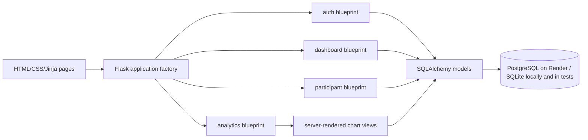

# Architecture

`app.create_app()` wires Flask-Login, CSRF, SQLAlchemy, Flask-Migrate, static assets, and blueprints. Route functions validate requests, apply ownership/status checks, and commit a transaction through the ORM. Jinja autoescapes titles, descriptions, prompts, and text answers. Static design assets remain under `assets/`; app workflow styles are in `app/static/app.css`.

An owner creates a draft; questions/options are stored as rows. Publication gives participants a random opaque token. A participant GET resolves only published studies. POST validates question IDs and type-specific values against the current saved question configuration, checks the idempotency key and any scheduled close time, then stores one submission and its answers in a transaction. Owners query stored values through authenticated result/export routes; CSS charts render the option/rating distributions and response timeline without a charting service.

Database migrations are forward-only. Render's current free-plan configuration runs `flask --app wsgi db upgrade` before Gunicorn in the start command. On every process start Alembic checks and applies pending revisions; for this single-instance portfolio service, this avoids dependence on an inaccessible Render Shell. Scale-out should move migrations to a serialized release/pre-deploy job before adding instances.
