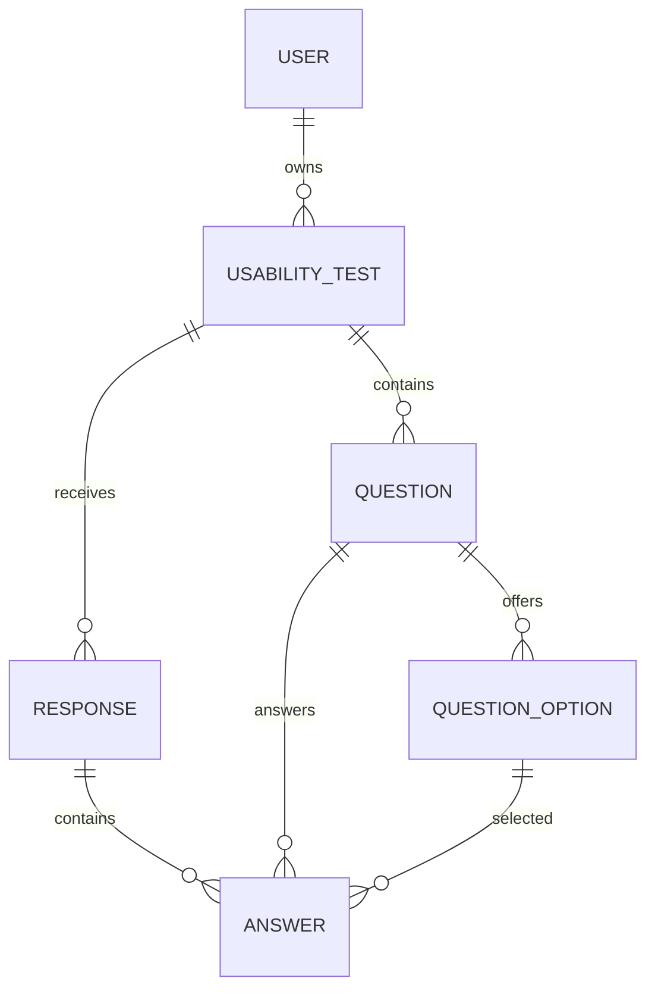

# Database schema

| Table | Purpose and key constraints |
| --- | --- |
| `user` | Unique indexed email, password hash, creation time. |
| `usability_test` | Owner FK, title/description, methodology, opaque unique public token, status, publication/closure/scheduled-close timestamps, legacy `is_published` compatibility field. |
| `question` | Test FK, prompt, type, required flag, order, helper text, optional rating range; check constraints enforce supported types and valid ranges. |
| `question_option` | Ordered option rows belonging to choice questions. |
| `response` | Test FK, submitted timestamp, unique per-test idempotency key. A new participant page load receives a new key, so fresh repeat submissions remain allowed. |
| `answer` | Response and question FKs; either an option reference or free text/rating value. Multi-select questions may store several option rows for one response/question. |

Checks constrain study lifecycle values, methodologies, supported question types, rating bounds, and the answer representation (one option or one scalar value per row). A legacy `is_published` boolean remains synchronized by application transitions for compatibility; `status` determines public access. Existing `multiple_choice` rows are migrated to `single_choice` because that was the old radio-button behavior.

Deleting a test cascades through its questions, options, responses, and answers. Application policy prevents deleting tests with responses and locks question structure after the first response. Users are not currently exposed to self-service deletion. Migration revisions are in `migrations/versions`; run `flask --app wsgi db upgrade` to apply them.
